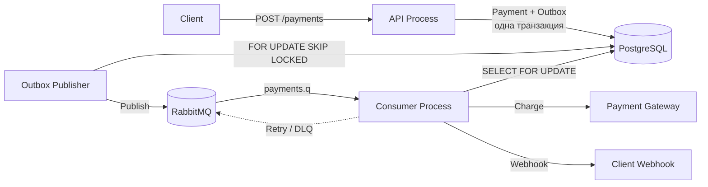

# Payments Service

Асинхронный микросервис процессинга платежей на Python. Принимает запросы на оплату, обрабатывает платежи через эмуляцию внешнего платёжного шлюза и уведомляет клиентов через webhook.

Проект демонстрирует **Transactional Outbox, идемпотентность, асинхронную обработку сообщений, retry/DLQ и работу с PostgreSQL и RabbitMQ**.

## Содержание

- [Технологический стек](#технологический-стек)
- [Архитектура](#архитектура)
- [Быстрый старт](#быстрый-старт)
- [Примеры API](#примеры-api)
- [Контракт идемпотентности](#контракт-идемпотентности)
- [Retry и DLQ](#retry-и-dlq)
- [Локальная разработка](#локальная-разработка)
- [Тестирование](#тестирование)
- [Dev Container](#dev-container)
- [Структура проекта](#структура-проекта)
- [Ограничения и компромиссы](#ограничения-и-компромиссы)
- [Качество кода](#качество-кода)
- [Миграции](#миграции)
- [Лицензия](#лицензия)

## Технологический стек

| Компонент | Технологии |
|---|---|
| Язык | Python 3.14 |
| API | FastAPI, Pydantic v2 |
| База данных | PostgreSQL 16, SQLAlchemy 2.0 Async |
| Миграции | Alembic |
| Брокер сообщений | RabbitMQ 3.13, FastStream 0.6 |
| Управление зависимостями | uv, PEP 621, PEP 735, `uv.lock` |
| Контейнеризация | Docker, Docker Compose |
| Тестирование | pytest, pytest-asyncio, Testcontainers |
| Качество кода | Ruff, mypy |

## Архитектура

Система состоит из трёх независимых процессов: API, Outbox Publisher и Consumer.



### API

- Принимает HTTP-запросы на создание и получение платежей.
- Проверяет API-ключ и валидирует входные данные.
- Создаёт запись платежа и событие Outbox в одной транзакции PostgreSQL.
- Поддерживает идемпотентность по `Idempotency-Key`.
- Не подключается к RabbitMQ и не публикует сообщения напрямую.

### Outbox Publisher

- Выбирает ожидающие публикации события со статусом `PENDING`.
- Использует `SELECT ... FOR UPDATE SKIP LOCKED` для выборки записей.
- Публикует события в RabbitMQ.
- После успешной публикации помечает событие как `PUBLISHED`.

Transactional Outbox позволяет сохранить платёж и событие в одной транзакции БД, не теряя событие при сбое между записью платежа и публикацией сообщения.

### Consumer

- Получает события из RabbitMQ.
- Блокирует запись платежа через `SELECT FOR UPDATE`.
- Выполняет обработку платежа через эмулятор внешнего шлюза.
- Сохраняет результат и отправляет webhook.
- При инфраструктурных ошибках использует retry с увеличивающейся задержкой.
- После исчерпания попыток направляет сообщение в Dead Letter Queue (DLQ).

## Быстрый старт

### Требования

- Docker и Docker Compose
- Git
- Доступные порты `8000`, `5432`, `5672` и `15672`

### Запуск

Склонируйте репозиторий и перейдите в каталог проекта:

```bash
git clone <repository-url>
cd payments-service
```

Создайте файл конфигурации:

```bash
cp .env.example .env
```

Укажите `API_KEY` в `.env`. Используйте собственное значение, а не пример из документации.

Запустите сервисы:

```bash
docker compose up -d --build
```

Миграции применяются сервисом `migrate` до запуска приложения.

После старта доступны:

| Сервис | Адрес |
|---|---|
| API | http://localhost:8000 |
| Swagger UI | http://localhost:8000/docs |
| RabbitMQ Management | http://localhost:15672 |
| PostgreSQL | `localhost:5432` |

Для локального окружения RabbitMQ Management по умолчанию использует `guest / guest`, если это предусмотрено конфигурацией Compose.

## Примеры API

Все API-запросы требуют заголовок `X-API-Key`.

### Создание платежа

```bash
curl -i -X POST http://localhost:8000/api/v1/payments \
  -H "X-API-Key: YOUR_API_KEY" \
  -H "Idempotency-Key: order-42" \
  -H "Content-Type: application/json" \
  -d '{
    "amount": "1499.90",
    "currency": "RUB",
    "description": "Order #42",
    "metadata": {
      "user_id": 7,
      "cart_id": "abc"
    },
    "webhook_url": "https://example.com/webhooks/payments"
  }'
```

Пример ответа:

```http
HTTP/1.1 202 Accepted
Content-Type: application/json
```

```json
{
  "payment_id": "922d03cc-95c7-4070-b554-f7239d4bbe7e",
  "status": "pending",
  "created_at": "2026-01-01T12:00:00Z"
}
```

Используется `202 Accepted`, поскольку запрос принят, но обработка платежа выполняется асинхронно. Статус `pending` не означает, что платёж уже успешно завершён.

### Получение платежа

```bash
curl -s \
  http://localhost:8000/api/v1/payments/<payment_id> \
  -H "X-API-Key: YOUR_API_KEY" | python -m json.tool
```

### Повторный запрос с тем же ключом

Повторите запрос с тем же `Idempotency-Key`. Сервис вернёт исходный платёж, даже если валидное тело запроса отличается от первоначального.

```bash
curl -i -X POST http://localhost:8000/api/v1/payments \
  -H "X-API-Key: YOUR_API_KEY" \
  -H "Idempotency-Key: order-42" \
  -H "Content-Type: application/json" \
  -d '{
    "amount": "9999.99",
    "currency": "USD",
    "description": "Different order",
    "metadata": {},
    "webhook_url": "https://example.com/webhooks/payments"
  }'
```

### Проверка DLQ

Посмотрите состояние очередей:

```bash
docker compose exec rabbitmq rabbitmqctl list_queues name messages
```

Прочитать сообщение из DLQ можно командой:

```bash
docker compose exec rabbitmq rabbitmqadmin get \
  queue=payments.dlq count=1
```

Команда чтения через `rabbitmqadmin` зависит от версии и способа установки утилиты в контейнере.

## Контракт идемпотентности

Для предотвращения создания дубликатов клиент передаёт заголовок `Idempotency-Key`.

| Сценарий | Результат |
|---|---|
| Новый ключ | Создаётся платёж, возвращается `202 Accepted` |
| Повторный запрос с тем же ключом | Возвращается исходный платёж |
| Тот же ключ, другое валидное тело | Возвращается исходный платёж, новое тело игнорируется |
| Тот же ключ, невалидное тело | Возвращается `422 Unprocessable Entity` |
| Параллельные запросы с одним ключом | Оба запроса получают один `payment_id` |

### Особенности реализации

- Уникальность ключа обеспечивается ограничением БД `uq_payments_idempotency_key`.
- При конкурентной вставке конфликт уникальности обрабатывается через `IntegrityError`.
- После конфликта выполняется rollback, затем повторный поиск существующего платежа.
- Валидация тела выполняется FastAPI/Pydantic до вызова обработчика маршрута. Поэтому невалидное тело получает `422`, даже если ключ уже существует.

Сравнение хешей тела запроса не используется: повторный ключ трактуется как ссылка на исходную операцию. Такой контракт упрощает обработку повторных запросов, но должен быть явно согласован с клиентами API.

## Retry и DLQ

Каждая попытка обработки сообщения хранится в поле `attempt` (payload, не
`x-death`). Количество retry-стадий и их задержки вычисляются автоматически
из конфигурации:

```
PROCESS_MAX_ATTEMPTS = N      → N-1 retry-стадий
RETRY_BASE_DELAY_MS = B       → базовая задержка
RETRY_MULTIPLIER = M          → множитель экспоненты
RETRY_MAX_DELAY_MS = C        → потолок задержки
```

Задержка i-й стадии: `min(B * M**i, C)`, где `i = 0..N-2`.

Пример при `N=3, B=5000, M=2.0, C=300000`:

```
attempt=1: payments.q → consumer
           fail → payments.retry.5000ms.q

attempt=2 (через 5с): retry.5000ms.q → DLX → payments.q → consumer
           fail → payments.retry.10000ms.q

attempt=3 (через 10с): retry.10000ms.q → DLX → payments.q → consumer
           fail → payments.dlx → payments.dlq
```

Пример при `N=5, B=5000, M=2.0, C=300000`:

```
retry.5000ms.q → retry.10000ms.q → retry.20000ms.q → retry.40000ms.q → DLQ
```

**Расширение количества попыток не требует правок в коде.** Достаточно
изменить `PROCESS_MAX_ATTEMPTS` в `.env` и перезапустить сервисы.
`declare_topology` при старте создаст нужное количество retry-очередей.

**Имена retry-очередей включают TTL:** `payments.retry.5000ms.q`.
Изменение `RETRY_BASE_DELAY_MS` или `RETRY_MULTIPLIER` приводит к созданию
очередей с новыми именами. Старые очереди автоматически не удаляются и
требуют ручной очистки через Management UI.

**Safety net.** У `payments.q` есть `x-dead-letter-exchange=payments.dlx`.
Если `_route_after_failure` в consumer'е сам упадёт (публикация не
подтвердилась, брокер недоступен), FastStream с `ack_policy=REJECT_ON_ERROR`
вызовет `reject(requeue=False)`, и исходное сообщение уйдёт в DLQ через
dead-lettering. Ничего не теряется.

### Защита от ошибки публикации retry

У основной очереди `payments.q` настроен `x-dead-letter-exchange=payments.dlx`.

Если обработчик ошибки не может опубликовать сообщение в retry-очередь, consumer должен завершить обработку ошибкой. При соответствующей конфигурации `ack_policy=REJECT_ON_ERROR` исходное сообщение отклоняется без повторной постановки в очередь и направляется в DLQ через dead-letter exchange.

Этот механизм снижает риск потери сообщения при ошибке retry-маршрутизации, но не заменяет настройку publisher confirms, контроль маршрутизации и мониторинг DLQ.

## Локальная разработка

При локальной разработке инфраструктура запускается в Docker, а приложение, через `uv`.

### 1. Запуск инфраструктуры

```bash
docker compose up -d postgres rabbitmq
```

### 2. Установка зависимостей

```bash
uv sync --all-groups
```

### 3. Применение миграций

```bash
uv run alembic upgrade head
```

Проверьте, что переменные окружения в `.env` соответствуют запущенным сервисам.

### 4. Запуск приложения

Запускайте API, consumer и Outbox Publisher в отдельных терминалах:

```bash
uv run uvicorn payments.main:app --reload
```

```bash
uv run faststream run payments.messaging.consumer:app
```

```bash
uv run python -m payments.workers.outbox_publisher
```

## Тестирование

Для интеграционных тестов используются Testcontainers: PostgreSQL и RabbitMQ запускаются в контейнерах, после чего применяются миграции Alembic.

### Unit-тесты

```bash
uv run pytest tests/unit -v
```

### Интеграционные тесты

```bash
uv run pytest tests/integration -v
```

Для этого режима необходим работающий Docker daemon.

### Все тесты

```bash
uv run pytest -v
```

Интеграционные тесты используют реальные PostgreSQL и RabbitMQ, а не моки на уровне SQL. Между тестами очищаются таблицы БД и при необходимости очереди RabbitMQ.

В `pyproject.toml` настроены:

- `asyncio_mode = "auto"`, автоматическая поддержка асинхронных тестов;
- `asyncio_default_fixture_loop_scope = "session"`, область event loop для async-фикстур;
- маркеры `unit` и `integration`.

Для запуска только unit-тестов можно использовать:

```bash
uv run pytest -m unit -v
```

## Dev Container

Dev Container, необязательный вариант разработки в VS Code без установки Python и `uv` на хосте.

1. Откройте проект в VS Code.
2. Выберите `Dev Containers: Reopen in Container`.
3. В контейнере выполните `uv sync --all-groups`.
4. Запустите PostgreSQL и RabbitMQ на хосте:

   ```bash
   docker compose up -d postgres rabbitmq
   ```

5. Dev Container подключён в ту же docker-сеть `payments-service_default`,
что и compose-сервисы. Обращение к PostgreSQL и RabbitMQ идёт по именам
сервисов (`postgres:5432`, `rabbitmq:5672`).

Dev Container не обязателен: весь проект можно запустить командой `docker compose up -d --build`.

## Структура проекта

```text
src/payments/
├── main.py
├── core/
│   ├── config.py
│   └── logging.py
├── db/
│   ├── base.py
│   └── session.py
├── models/
│   ├── payment.py
│   └── outbox.py
├── schemas/
│   ├── payment.py
│   └── events.py
├── repositories/
│   ├── payments.py
│   └── outbox.py
├── services/
│   ├── payments.py
│   ├── gateway.py
│   └── webhooks.py
├── api/
│   ├── dependencies.py
│   └── v1/
│       └── payments.py
├── messaging/
│   ├── broker.py
│   ├── topology.py
│   ├── publisher.py
│   └── consumer.py
└── workers/
    └── outbox_publisher.py
```

| Модуль | Назначение |
|---|---|
| `main.py` | FastAPI-приложение и lifespan |
| `core/config.py` | Конфигурация приложения |
| `db/session.py` | Создание и управление SQLAlchemy-сессиями |
| `models/` | ORM-модели платежа и Outbox |
| `schemas/` | Pydantic-схемы API и событий |
| `repositories/` | Работа с данными и блокировками |
| `services/payments.py` | Создание, получение и обработка платежей |
| `services/gateway.py` | Эмуляция платёжного шлюза |
| `services/webhooks.py` | Доставка webhook и SSRF-фильтр |
| `messaging/` | RabbitMQ, топология, публикация и consumer |
| `workers/outbox_publisher.py` | Цикл публикации событий Outbox |

## Ограничения и компромиссы

Проект предназначен для демонстрации архитектурных подходов и не является готовым production-платёжным решением.

### Эмулятор PSP не обеспечивает идемпотентность

Если процесс завершится после успешного внешнего списания, но до фиксации результата в БД, повторная доставка сообщения может вызвать повторное списание.

В реальной интеграции необходимо передавать поддерживаемый платёжным провайдером ключ идемпотентности и предусмотреть сверку состояния платежей.

### Publisher confirms не гарантируют маршрутизацию

`publisher_confirms=True` подтверждает публикацию на стороне RabbitMQ, но сам по себе не гарантирует доставку сообщения в ожидаемую очередь.

В production-системе рекомендуется использовать `mandatory=True`, обработку `basic.return` и оповещения о неразмаршрутизированных сообщениях.

### Секреты хранятся в переменных окружения

`.env` удобен для локальной разработки, но не является полноценным решением управления секретами для production. Там следует использовать специализированное хранилище секретов или механизм секретов платформы развёртывания.

### Outbox Publisher удерживает блокировки во время публикации

`_drain_once` удерживает блокировки выбранных строк БД во время сетевых вызовов к RabbitMQ. Для небольшого локального сервиса это упрощает реализацию, но при высокой нагрузке увеличивает продолжительность транзакций.

Для production-нагрузки можно использовать короткое резервирование записей, публикацию вне транзакции и механизм восстановления зависших записей.

### Некорректные события Outbox

Если payload события повреждён или не проходит валидацию, запись может остаться в `PENDING` и повторно обрабатываться при каждой итерации publisher.

Для production необходимо предусмотреть отдельный статус ошибки, метрики, алертинг и механизм ручного восстановления.

### Retry-очереди после изменения TTL

Изменение `RETRY_BASE_DELAY_MS` или `RETRY_MULTIPLIER` приводит к созданию очередей с новыми именами. Старые очереди автоматически не удаляются и требуют ручной или автоматизированной очистки через Management UI.

## Качество кода

Проверка линтером:

```bash
uv run ruff check src tests
```

Автоформатирование:

```bash
uv run ruff format src tests
```

Статическая проверка типов:

```bash
uv run mypy src tests
```

Конфигурация инструментов находится в `pyproject.toml`. Используется стиль с ограничением длины строки 120 символов и строгая проверка типов mypy.

## Миграции

Создать новую миграцию:

```bash
uv run alembic revision --autogenerate -m "describe change"
```

Применить миграции:

```bash
uv run alembic upgrade head
```

Откатить последнюю миграцию:

```bash
uv run alembic downgrade -1
```

Перед применением автогенерированной миграции проверьте изменения вручную. Alembic может некорректно определить изменения `server_default` или типов PostgreSQL ENUM.

## Лицензия

Тестовое задание. Не предназначено для использования в production без дополнительной доработки и проверки требований безопасности и надёжности.